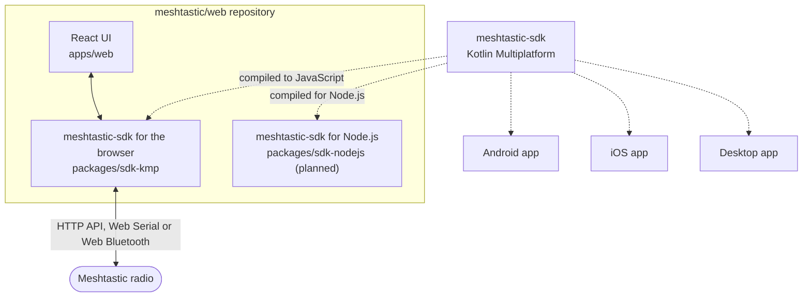

<h1 align="center">Meshtastic Web</h1>

<p align="center">
  <strong>The Meshtastic client for your browser</strong><br>
  Talk to your Meshtastic radio over Bluetooth, USB serial or Wi-Fi, with nothing to install
</p>

<p align="center">
  <a href="https://client.meshtastic.org">Open the client</a> •
  <a href="https://meshtastic.org/docs/introduction/">Meshtastic docs</a> •
  <a href="#how-it-works">How it works</a> •
  <a href="./CONTRIBUTING.md">Contributing</a>
</p>

<p align="center">

[](https://github.com/meshtastic/web/actions/workflows/ci.yml)
[](https://cla-assistant.io/meshtastic/web)
[](https://opencollective.com/meshtastic/)
[](https://vercel.com?utm_source=meshtastic&utm_campaign=oss)

</p>

## Overview

Meshtastic Web is the official [Meshtastic](https://meshtastic.org) client for the browser, hosted at [client.meshtastic.org](https://client.meshtastic.org). It connects to a radio over the device's HTTP API, Web Serial or Web Bluetooth (Web Serial and Web Bluetooth need a Chromium-based browser). The device-side code lives in the [firmware repository](https://github.com/meshtastic/firmware).

It speaks to radios through the same Kotlin Multiplatform [meshtastic-sdk](https://github.com/meshtastic/meshtastic-sdk) as the Android, iOS and Desktop apps, compiled to JavaScript. Connection handling, the node database and the protocol behave the same way across every Meshtastic app.

If you have questions or feedback, join the [discussion forum](https://github.com/orgs/meshtastic/discussions) or [Discord](https://discord.gg/meshtastic).

## Features

- **Messaging**: channel and direct messages, with unread counts per conversation.
- **Map**: node positions and waypoints.
- **Nodes**: node list with signal, hops, telemetry and device details.
- **Radio configuration**: device, LoRa, channel, security and module settings, plus config backup and restore.
- **Connections**: save several radios and switch between them; the SDK reconnects automatically.
- **Offline-friendly**: the node database, config and channels are kept in browser storage between sessions.
- **Translations**: the UI is translated by the community on [Crowdin](./CONTRIBUTING_TRANSLATIONS.md).

## How it works

The web client doesn't implement the Meshtastic protocol itself. It uses [meshtastic-sdk](https://github.com/meshtastic/meshtastic-sdk), the same Kotlin Multiplatform library behind the Android, iOS and Desktop apps, compiled to JavaScript:



- **One SDK, every app.** Connecting to a radio, the node database and the protocol itself live in the SDK, so they behave the same in every Meshtastic app, and a fix there reaches all of them.
- **Built with the web client.** `packages/sdk-kmp` compiles the SDK to a JavaScript module that the web client imports like any other package. This is why building needs JDK 21.
- **Node.js next.** A planned `packages/sdk-nodejs` will build the same SDK for Node.js, so code outside the browser can talk to radios the same way.
- **The browser supplies the connection and storage.** The web build adds the browser's ways of reaching a radio (the device HTTP API, Web Serial and Web Bluetooth) and keeps nodes, config and channels in browser storage.
- **The UI stays in React.** `apps/web` turns what the SDK reports into the screens for messages, the map, nodes and radio configuration.

For how the SDK is wrapped, built and pinned, see [`packages/sdk-kmp/README.md`](./packages/sdk-kmp/README.md).

## Repository layout

| Package | Purpose |
| --- | --- |
| `apps/web` | The React web client. |
| `packages/sdk-kmp` | The Kotlin meshtastic-sdk compiled to JavaScript, behind a small `@JsExport` facade plus browser transports and storage. Built with Gradle (JDK 21). |
| `packages/sdk-nodejs` | Planned: the meshtastic-sdk built for Node.js. |
| `packages/ui` | Shared Radix + Tailwind component library. |
| `packages/protobufs` | TypeScript stubs generated from [`meshtastic/protobufs`](https://github.com/meshtastic/protobufs) with `buf generate`. The source of truth for every wire-level type. |

All packages under `packages/` are private workspace packages; none are published to npm or JSR from this repository.

## Getting Started

### Prerequisites

- [Node.js](https://nodejs.org/) 24 (see `.nvmrc`)
- [pnpm](https://pnpm.io/), the version pinned in `package.json`'s `packageManager` field (Corepack picks it up)
- [JDK 21](https://adoptium.net/), to build `@meshtastic/sdk-kmp`. On macOS: `brew install openjdk@21` and `export JAVA_HOME=/opt/homebrew/opt/openjdk@21`.
- [Buf CLI](https://buf.build/docs/cli/installation/), only for a full build that regenerates `@meshtastic/protobufs`. Not needed to run the dev server.

### Setup

```bash
git clone --recurse-submodules https://github.com/meshtastic/web.git
cd web
pnpm install
```

If you cloned without `--recurse-submodules`, the SDK build runs `git submodule update --init` for you.

### Run the web client

```bash
pnpm --filter meshtastic-web dev
```

The first run builds `@meshtastic/sdk-kmp`, which takes a few minutes; later runs reuse it. The client is then at http://localhost:3000.

### Build

```bash
pnpm --filter meshtastic-web... build   # the web client and the packages it depends on
pnpm -r build                           # everything, including protobufs (needs Buf)
```

### Test, lint and format

```bash
pnpm test                                # all Vitest suites
pnpm --filter @meshtastic/sdk-kmp test   # the Kotlin/JS facade and transports
pnpm check                               # oxlint + oxfmt --check
pnpm check:fix                           # fix lint and formatting
```

See [TESTING.md](./TESTING.md) for the testing strategy, and [`e2e/README.md`](./e2e/README.md) for end-to-end tests against simulated nodes.

## Contributing

See [CONTRIBUTING.md](./CONTRIBUTING.md) for the workflow, branch and commit conventions, and PR guidelines. Translators can start with the [Translation Contribution Guide](./CONTRIBUTING_TRANSLATIONS.md); developers adding user-facing strings should read the [i18n Developer Guide](./CONTRIBUTING_I18N_DEVELOPER_GUIDE.md).

Changes to protocol or connection behaviour usually belong in [meshtastic-sdk](https://github.com/meshtastic/meshtastic-sdk), so every Meshtastic app benefits.

## Feedback

If you run into a problem, please report it in the [issue tracker](https://github.com/meshtastic/web/issues). Your feedback helps improve the stability of future releases.

## Repository activity

| Project        | Repobeats                                                                                                             |
| :------------- | :-------------------------------------------------------------------------------------------------------------------- |
| Meshtastic Web |  |

## Star history

<a href="https://star-history.com/#meshtastic/web&Date">
 <picture>
   <source media="(prefers-color-scheme: dark)" srcset="https://api.star-history.com/svg?repos=meshtastic/web&type=Date&theme=dark" />
   <source media="(prefers-color-scheme: light)" srcset="https://api.star-history.com/svg?repos=meshtastic/web&type=Date" />
   
 </picture>
</a>

## Contributors

<a href="https://github.com/meshtastic/web/graphs/contributors">
  
</a>

## License

GPL-3.0-only. See [LICENSE](LICENSE).
