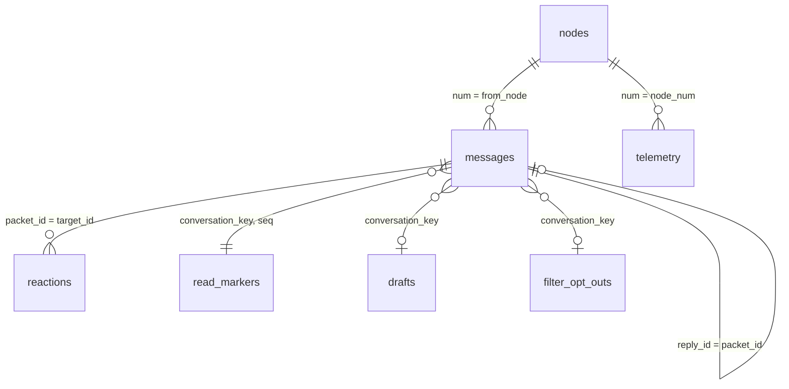

# App database schema

The web client's own SQLite database. It holds message history, reactions,
drafts, read markers, the message filter, and caches of the node DB and
telemetry. Source of truth: [`schema.ts`](./schema.ts). This file describes
**schema version 2** (`SCHEMA_VERSION`); if the two disagree, `schema.ts` wins.

- **File:** `meshtastic-app-v1.db` in the browser's Origin Private File System
  (OPFS), opened through sqlocal and queried with Drizzle.
- **Not shared with the SDK:** the Kotlin SDK keeps its own device state
  (config, channels, its NodeDB) in a separate database it manages itself
  (`core/kmp/browserStorage.ts`).
- **Scope:** every table has a `device_id` column, the node number of the
  radio the data belongs to.

## Tables

### `messages`

Text messages, one row per packet.

| Column | Type | Null | Notes |
| --- | --- | --- | --- |
| `seq` | INTEGER | no | Primary key, autoincrement. Local arrival order. |
| `device_id` | INTEGER | no | Radio node number. |
| `packet_id` | INTEGER | no | Mesh packet id (32-bit, random). |
| `conversation_key` | TEXT | no | `channel:<index>` or `direct:<peer node>`. |
| `from_node` | INTEGER | no | Sender node number. |
| `to_node` | INTEGER | no | Recipient node number, or broadcast. |
| `channel` | INTEGER | no | Channel index. |
| `type` | TEXT | no | `broadcast` or `direct`. |
| `rx_time` | INTEGER | no | Receive time from the radio, ms. |
| `text` | TEXT | no | Message body. |
| `reply_id` | INTEGER | yes | Packet id this message replies to. |
| `state` | TEXT | no | `pending`, `delivered`, `ack` or `failed`. |
| `routing_error` | INTEGER | yes | `Routing_Error` enum, when delivery failed. |
| `ack_proof` | INTEGER | yes | `MeshPacket_AckProofStatus` enum. |
| `relays` | INTEGER | yes | Acks heard for an outgoing message. |
| `signed` | INTEGER (bool) | yes | Packet was signed (PKI). |
| `snr` | REAL | yes | Signal-to-noise ratio. |
| `rssi` | INTEGER | yes | Signal strength. |
| `hops_away` | INTEGER | yes | Hops the packet took. |
| `via_mqtt` | INTEGER (bool) | yes | Arrived through MQTT. |
| `transport` | INTEGER | yes | `MeshPacket_TransportMechanism` enum. |
| `filtered` | INTEGER (bool) | no | Hidden by the message filter on arrival. Default 0. |

Indexes:

- `ux_messages_packet` UNIQUE on `(device_id, from_node, packet_id)`
- `idx_messages_packet_id` on `(device_id, packet_id)`
- `idx_messages_conv_rx` on `(device_id, conversation_key, rx_time, seq)`

### `reactions`

Tapback reactions to messages.

| Column | Type | Null | Notes |
| --- | --- | --- | --- |
| `device_id` | INTEGER | no | Part of the primary key. |
| `target_id` | INTEGER | no | Packet id of the message reacted to. Part of the primary key. |
| `from_node` | INTEGER | no | Who reacted. Part of the primary key. |
| `emoji_key` | TEXT | no | Emoji without variation selectors. Part of the primary key. |
| `emoji` | TEXT | no | Emoji as received. |
| `packet_id` | INTEGER | no | The reaction packet itself (acks refer to it). |
| `to_node` | INTEGER | no | Where the reaction was sent. |
| `conversation_key` | TEXT | no | Same format as `messages`. |
| `rx_time` | INTEGER | no | Receive time, ms. |
| `state` | TEXT | no | Same states as `messages`. |
| `routing_error` | INTEGER | yes | `Routing_Error` enum. |

The primary key is `(device_id, target_id, from_node, emoji_key)`. Indexes:

- `idx_reactions_packet` on `(device_id, from_node, packet_id)`
- `idx_reactions_conv` on `(device_id, conversation_key)`

### `drafts`

| Column | Type | Null | Notes |
| --- | --- | --- | --- |
| `device_id` | INTEGER | no | Part of the primary key. |
| `conversation_key` | TEXT | no | Part of the primary key. |
| `text` | TEXT | no | Unsent composer text. |
| `updated_at` | INTEGER | no | ms. |

### `read_markers`

| Column | Type | Null | Notes |
| --- | --- | --- | --- |
| `device_id` | INTEGER | no | Part of the primary key. |
| `conversation_key` | TEXT | no | Part of the primary key. |
| `last_read_seq` | INTEGER | no | Highest `messages.seq` read. |

### `nodes`

A snapshot of the radio's NodeDB.

| Column | Type | Null | Notes |
| --- | --- | --- | --- |
| `device_id` | INTEGER | no | Part of the primary key. |
| `num` | INTEGER | no | Node number. Part of the primary key. |
| `last_heard` | INTEGER | yes | Seconds; also indexed for sorting. |
| `snr` | INTEGER | yes | |
| `is_favorite` | INTEGER (bool) | no | Default 0. |
| `is_ignored` | INTEGER (bool) | no | Default 0. |
| `user_json` | TEXT | yes | `User` protobuf, base64. |
| `position_json` | TEXT | yes | `Position` protobuf, base64. |
| `metrics_json` | TEXT | yes | `DeviceMetrics` protobuf, base64. |

Index: `idx_nodes_last_heard` on `(device_id, last_heard)`.

### `telemetry`

| Column | Type | Null | Notes |
| --- | --- | --- | --- |
| `id` | INTEGER | no | Primary key, autoincrement. |
| `device_id` | INTEGER | no | |
| `node_num` | INTEGER | no | Node the reading is from. |
| `kind` | TEXT | no | Which telemetry variant (device, environment...). |
| `ts` | INTEGER | no | Reading time. |
| `payload_json` | TEXT | no | The reading. |

Index: `idx_telemetry_node_ts` on `(device_id, node_num, ts)`.

### `filter_words`, `filter_settings`, `filter_opt_outs`

The message filter, per radio.

| Table | Columns | Primary key |
| --- | --- | --- |
| `filter_words` | `device_id`, `pattern` (a word, or `regex:` and a pattern), `created_at` | `(device_id, pattern)` |
| `filter_settings` | `device_id`, `enabled` (bool, default 0; no row means off) | `device_id` |
| `filter_opt_outs` | `device_id`, `conversation_key` | `(device_id, conversation_key)` |

## How tables relate

There are no foreign keys; the links are by value, always within one
`device_id`.

## Lifecycle

- **No migrations.** The version lives in `PRAGMA user_version`. On open,
  `schemaStatements` re-runs the DDL when the version matches. When it
  doesn't (an empty file reads as 0), every table is dropped, the schema is
  recreated and the version is stamped.
- **Bumping the version.** Any DDL change needs a `SCHEMA_VERSION` bump.
  `schema.test.ts` pins the DDL for each version, so an edit without a bump
  fails the tests.
- **Before the radio is known.** A connection writes under a negative,
  provisional `device_id`. Once the handshake gives the radio's node number,
  `adopt.ts` moves those rows into the radio's history in one transaction.
- **Pruning.**
  - Messages are pruned by age and by a per-conversation cap, keeping the
    newest N by `rx_time` then `seq`. Reactions left without a message are
    removed with them.
  - Telemetry is pruned by age and by a per-node cap.

## How the decisions were made

### Starting from a clean database

You asked for SQLite storage to start fresh, with no need to keep old data.
Two things follow from that:

1. **A new file name** (`meshtastic-app-v1.db`), so a database written by an
   older release is never opened. An old schema can't break startup. The old
   file is deleted on a best-effort basis by the tab that owns storage.
2. **A version stamp that wipes on mismatch, instead of migrations.** All the
   data here can be rebuilt from the radio, except message history and
   drafts, which you said didn't need to survive. A migration chain would be
   code to maintain for no benefit. The DDL is hand-written in `SCHEMA_SQL`,
   not generated by drizzle-kit, so the database creates itself on first open
   with no build step.

### `device_id` is the radio's node number

History belongs to the radio, not to how you reached it. The same radio over
Bluetooth today and USB tomorrow should show one history. So each row is keyed
by the radio's node number, not by a connection id. The node number isn't
known until the handshake, which is why there is a provisional scope and
`adopt.ts`. When the provisional rows are merged in, rows already stored win
for the same message or reaction. The new connection's rows win for things
the user changed in the meantime: a draft, how far a conversation was read,
when a node was last heard.

### `messages`

- **`seq` as the primary key, not the packet id.** Packet ids are random
  32-bit values chosen by the sender, so they are only unique per sender. The
  old table keyed on `(device_id, id)` without a uniqueness constraint, so a
  retransmission could be stored twice. Now `seq` is a local autoincrement,
  and a unique index on `(device_id, from_node, packet_id)` stores a
  repeated packet once.
- **`seq` also gives a reliable order.** `rx_time` comes from the radio's
  clock, which can be missing or skewed. Unread counts and read markers
  compare `seq` values, which only ever increase. That's why `read_markers`
  stores a `seq`, not a timestamp.
- **`conversation_key` is one text column** (`channel:N` or `direct:PEER`).
  It is denormalised rather than derived from `type`, `channel` and the
  nodes, because a direct message you sent belongs to the recipient's
  conversation and one you received to the sender's. Storing the answer
  means every per-conversation query (the list, drafts, read markers, the
  filter opt-out) uses one equality on one indexed column.
- **`idx_messages_conv_rx` ends in `seq`,** so a conversation page reads
  `rx_time` then `seq` straight from the index, ties included.
- **`idx_messages_packet_id`** finds a message by packet id when an ack, a
  reply or a reaction arrives, without knowing the sender.
- **Signal and route data on the row** (`snr`, `rssi`, `hops_away`,
  `via_mqtt`, `transport`). The message list shows SNR or hops under each
  bubble, so these are columns rather than a separate table. Protobuf enums
  are stored as integers typed with `$type<...>`, so TypeScript sees the
  enum, not a bare number.
- **`filtered` is decided when the message arrives,** not at read time.
  Changing the filter later doesn't rewrite history, and a filtered message
  is never unread and never the conversation preview, without re-running the
  filter on every query.
- **`reply_id` is a packet id,** because that's what the protocol sends.

### `reactions` in its own table

Tapbacks arrive as packets, but they were kept out of `messages` on purpose:

- **The primary key is what the UI counts.** A reaction chip shows distinct
  senders per emoji, which is exactly `(target, sender, emoji)`. A repeated
  reaction packet is a no-op, and removing your own reaction is one delete.
- **They don't distort messages.** They don't use up the page size or the
  per-conversation cap, and they can't become a conversation's last-message
  preview or count as unread.
- **One lookup per page.** All reactions for a page of messages load with
  one indexed query on `target_id`.
- **`emoji_key` versus `emoji`.** The same emoji can arrive with or without
  a variation selector (❤ and ❤️). `emoji_key` drops the selector so they
  count as one; `emoji` keeps the spelling that was received.
- **Delivery is tracked like a message.** `packet_id` and `to_node` let an
  ack mark your reaction delivered, so reactions have their own `state`.

### `drafts` and `read_markers`

Both are one row per conversation, keyed `(device_id, conversation_key)`, so
saving is an upsert and there's never more than one draft or marker per
conversation.

### Message filter tables (schema version 2)

The filter is per radio, as on Android, so all three tables are keyed by
`device_id`.

- **`filter_words`** uses the pattern itself in the primary key, so adding
  the same word twice is a no-op.
- **`filter_settings`** treats a missing row as off, so a radio you've never
  set up needs no row.
- **`filter_opt_outs`** turns the filter off for single conversations.

Adding these tables is what moved the schema to version 2.

### `nodes` and `telemetry`, kept from main

These predate this branch and kept their shape, apart from one change: the
`node_info` column was dropped, because nothing in the app read or wrote it
any more.

- **Protobuf bytes, not columns.** User, position and metrics are stored as
  base64 protobuf. The `_json` suffix is historical. The UI reads them whole,
  so splitting them into columns would add mapping code with no query that
  needs it.
- **`last_heard` is a real column** so the node list can sort on an index.
- **Telemetry** is append-only. It is keyed by an autoincrement `id`, with
  one index on `(device_id, node_num, ts)` for "this node's readings over
  time" and for the per-node cap.

### What was deliberately left out

- **No foreign keys.** Rows arrive out of order (a reaction or ack before
  its message, a message from a node not in the NodeDB yet), and SQLite
  enforces foreign keys per connection. Links are by value; orphans are
  cleaned up when pruning.
- **No channel or config tables.** The SDK owns device configuration.
  Duplicating it here would create two sources of truth.

## Known gaps

- **Wrong order when clocks are bad.** The message list shows messages in
  arrival order. Pruning and the conversation index use `rx_time`, so a
  radio with a badly wrong clock can make the two disagree about which
  messages are newest.
