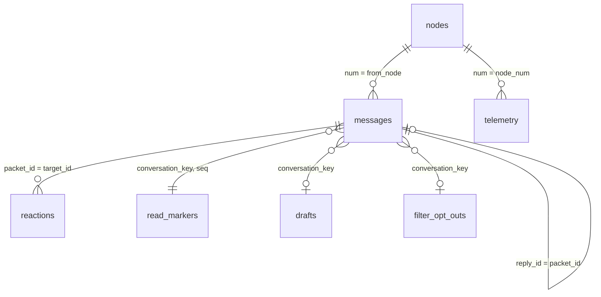

# App database schema

The web client's own SQLite database. It holds message history, reactions,
drafts, read markers, the message filter, and caches of the node DB and
telemetry. Source of truth: [`schema.ts`](./schema.ts). This file describes
**schema version 4** (`SCHEMA_VERSION`); if the two disagree, `schema.ts` wins.

- **File:** `meshtastic-app-v1.db` in the browser's Origin Private File System
  (OPFS), opened through sqlocal and queried with Drizzle.
- **Not shared with the SDK:** the Kotlin SDK keeps its own device state
  (config, channels, its NodeDB) in a separate database it manages itself
  (`core/kmp/browserStorage.ts`).
- **Scope:** every table has a `device_id` column, the node number of the
  radio the data belongs to.

## Tables

### `messages`

Text messages, one row per packet.

| Column | Type | Null | Notes |
| --- | --- | --- | --- |
| `seq` | INTEGER | no | Primary key, autoincrement. Local arrival order. |
| `device_id` | INTEGER | no | Radio node number. |
| `packet_id` | INTEGER | no | Mesh packet id (32-bit, random). |
| `conversation_key` | TEXT | no | `channel:<index>` or `direct:<peer node>`. |
| `from_node` | INTEGER | no | Sender node number. |
| `to_node` | INTEGER | no | Recipient node number, or broadcast. |
| `channel` | INTEGER | no | Channel index. |
| `type` | TEXT | no | `broadcast` or `direct`. |
| `rx_time` | INTEGER | no | Receive time from the radio, ms. |
| `text` | TEXT | no | Message body. |
| `reply_id` | INTEGER | yes | Packet id this message replies to. |
| `state` | TEXT | no | `pending`, `delivered`, `ack` or `failed`. |
| `routing_error` | INTEGER | yes | `Routing_Error` enum, when delivery failed. |
| `ack_proof` | INTEGER | yes | `MeshPacket_AckProofStatus` enum. |
| `relays` | INTEGER | yes | Acks heard for an outgoing message. |
| `signed` | INTEGER (bool) | yes | Packet was signed (PKI). |
| `snr` | REAL | yes | Signal-to-noise ratio. |
| `rssi` | INTEGER | yes | Signal strength. |
| `hops_away` | INTEGER | yes | Hops the packet took. |
| `via_mqtt` | INTEGER (bool) | yes | Arrived through MQTT. |
| `transport` | INTEGER | yes | `MeshPacket_TransportMechanism` enum. |
| `filtered` | INTEGER (bool) | no | Hidden by the message filter on arrival. Default 0. |
| `relay_node` | INTEGER | yes | Last byte of the relaying node's number (`MeshPacket.relay_node`): of a received message, or of the latest ack of an outgoing one. Since version 3. |

Indexes:

- `ux_messages_packet` UNIQUE on `(device_id, from_node, packet_id)`
- `idx_messages_packet_id` on `(device_id, packet_id)`
- `idx_messages_conv_rx` on `(device_id, conversation_key, rx_time, seq)`

### `reactions`

Tapback reactions to messages.

| Column | Type | Null | Notes |
| --- | --- | --- | --- |
| `device_id` | INTEGER | no | Part of the primary key. |
| `target_id` | INTEGER | no | Packet id of the message reacted to. Part of the primary key. |
| `from_node` | INTEGER | no | Who reacted. Part of the primary key. |
| `emoji_key` | TEXT | no | Emoji without variation selectors. Part of the primary key. |
| `emoji` | TEXT | no | Emoji as received. |
| `packet_id` | INTEGER | no | The reaction packet itself (acks refer to it). |
| `to_node` | INTEGER | no | Where the reaction was sent. |
| `conversation_key` | TEXT | no | Same format as `messages`. |
| `rx_time` | INTEGER | no | Receive time, ms. |
| `state` | TEXT | no | Same states as `messages`. |
| `routing_error` | INTEGER | yes | `Routing_Error` enum. |

The primary key is `(device_id, target_id, from_node, emoji_key)`. Indexes:

- `idx_reactions_packet` on `(device_id, from_node, packet_id)`
- `idx_reactions_conv` on `(device_id, conversation_key)`

### `drafts`

| Column | Type | Null | Notes |
| --- | --- | --- | --- |
| `device_id` | INTEGER | no | Part of the primary key. |
| `conversation_key` | TEXT | no | Part of the primary key. |
| `text` | TEXT | no | Unsent composer text. |
| `updated_at` | INTEGER | no | ms. |

### `read_markers`

| Column | Type | Null | Notes |
| --- | --- | --- | --- |
| `device_id` | INTEGER | no | Part of the primary key. |
| `conversation_key` | TEXT | no | Part of the primary key. |
| `last_read_seq` | INTEGER | no | Highest `messages.seq` read. |

### `nodes`

A snapshot of the radio's NodeDB.

| Column | Type | Null | Notes |
| --- | --- | --- | --- |
| `device_id` | INTEGER | no | Part of the primary key. |
| `num` | INTEGER | no | Node number. Part of the primary key. |
| `last_heard` | INTEGER | yes | Seconds; also indexed for sorting. |
| `snr` | INTEGER | yes | |
| `is_favorite` | INTEGER (bool) | no | Default 0. |
| `is_ignored` | INTEGER (bool) | no | Default 0. |
| `user_json` | TEXT | yes | `User` protobuf, base64. |
| `position_json` | TEXT | yes | `Position` protobuf, base64. |
| `metrics_json` | TEXT | yes | `DeviceMetrics` protobuf, base64. |
| `channel` | INTEGER | yes | Channel index the node was heard on. Since version 4. |
| `via_mqtt` | INTEGER (bool) | yes | Last heard through MQTT. Since version 4. |
| `hops_away` | INTEGER | yes | Hops to the node; null when unknown. Since version 4. |
| `is_key_manually_verified` | INTEGER (bool) | yes | Public key verified by hand. Since version 4. |
| `is_muted` | INTEGER (bool) | yes | Notifications muted. Since version 4. |
| `has_xeddsa_signed` | INTEGER (bool) | yes | Signs its packets with XEdDSA. Since version 4. |
| `status` | TEXT | yes | Latest status message (`NODE_STATUS_APP`). Since version 4. |

Index: `idx_nodes_last_heard` on `(device_id, last_heard)`.

### `telemetry`

| Column | Type | Null | Notes |
| --- | --- | --- | --- |
| `id` | INTEGER | no | Primary key, autoincrement. |
| `device_id` | INTEGER | no | |
| `node_num` | INTEGER | no | Node the reading is from. |
| `kind` | TEXT | no | Which telemetry variant (device, environment...). |
| `ts` | INTEGER | no | Reading time. |
| `payload_json` | TEXT | no | The reading. |

Index: `idx_telemetry_node_ts` on `(device_id, node_num, ts)`.

### `filter_words`, `filter_settings`, `filter_opt_outs`

The message filter, per radio.

| Table | Columns | Primary key |
| --- | --- | --- |
| `filter_words` | `device_id`, `pattern` (a word, or `regex:` and a pattern), `created_at` | `(device_id, pattern)` |
| `filter_settings` | `device_id`, `enabled` (bool, default 0; no row means off) | `device_id` |
| `filter_opt_outs` | `device_id`, `conversation_key` | `(device_id, conversation_key)` |

## How tables relate

There are no foreign keys; the links are by value, always within one
`device_id`.

## Lifecycle

- **Two stamps.** The schema version lives in `PRAGMA user_version`. The
  minimum reader version, the oldest app schema that can still safely read
  and write the file, lives in the `schema_meta` table (see below).
- **On open,** `applySchema` reads them and runs what `schemaStatements`
  returns, all in one `BEGIN IMMEDIATE` transaction:
  - **Current version:** the idempotent DDL (`SCHEMA_SQL`) again, and the
    minimum reader version recorded if the file has none yet.
  - **Older, and migratable:** the steps in `MIGRATIONS` from that version
    up to `SCHEMA_VERSION`, in order, then the idempotent DDL, then both
    stamps. Rows are kept.
  - **Newer, and the app meets its minimum reader version:** a reverted
    deploy, an old tab or a stale cached bundle (the PWA service worker)
    opening a file a later release wrote. Only the idempotent
    `IF NOT EXISTS` DDL runs; nothing is dropped and neither stamp changes,
    so the later release finds its file as it left it.
  - **Anything else:** an empty file (version 0), a version older than
    `FIRST_MIGRATABLE_VERSION` or missing a step, or a newer version whose
    minimum reader version is above the app's (or that has none). Every
    table is dropped, the schema is created and both stamps are written.
- **One transaction.** SQLite keeps `user_version` in the file header and
  `schema_meta` is an ordinary table; the transaction covers both. A failed
  step rolls back the data, the DDL and the stamps together: the file stays
  at its old version and the next open tries again.
- **Other tabs.** A tab opening the file while another holds the lock waits
  only a bounded time. After that its open fails; that connection runs
  without storage, and `getStorageDb` (`core/sdkStorage.ts`) tries again on
  its next call rather than keeping the failure.
- **Changing the schema.** Any DDL change needs a `SCHEMA_VERSION` bump, a
  `MIGRATIONS` entry for the previous version and a decision on
  `MIN_READER_VERSION` (see [Writing a migration](#writing-a-migration)).
  `schema.test.ts` pins the DDL for each version, checks a step exists for
  every migratable version, and checks that upgrading a frozen version 2
  database ends with the same tables, columns, CHECK clauses and indexes
  (`index_xinfo`, and uniqueness) as a fresh one.
- **Before the radio is known.** A connection writes under a negative,
  provisional `device_id`. Once the handshake gives the radio's node number,
  `adopt.ts` moves those rows into the radio's history in one transaction.
- **Pruning.**
  - Messages are pruned by age and by a per-conversation cap, keeping the
    newest N by `rx_time` then `seq`. Reactions left without a message are
    removed with them.
  - Telemetry is pruned by age and by a per-node cap.

## Writing a migration

1. Change the table in `schema.ts` (Drizzle) and in `SCHEMA_SQL`.
2. Bump `SCHEMA_VERSION` to N+1 and add `MIGRATIONS[N]`, the statements
   that take a version N file to N+1.
3. Decide the minimum reader version. An additive change (a nullable
   column, a new table or index) keeps `MIN_READER_VERSION` where it was:
   older code ignores what it doesn't know. A change older code would
   misread (a column it relies on renamed or retyped, rows it would
   mishandle) raises it to the new version, so an older release wipes the
   file instead of corrupting it.
4. Update the snapshot (`vitest run -u` on `schema.test.ts`), this file's
   tables and the changelog below.

Prefer additive changes: `ALTER TABLE ... ADD COLUMN`, a new table, a new
index. A new index needs no step of its own, since the idempotent
`SCHEMA_SQL` runs after the steps and creates it. A later step that drops
or replaces such an index must use `DROP INDEX IF EXISTS`: a file
upgraded across both versions never had it. A new table does: its
step runs `CREATE TABLE` with the table as it is at that version, and
`SCHEMA_SQL` keeps the current definition for fresh files. A file several
versions behind runs every step before `SCHEMA_SQL`, so a later step that
alters the table would otherwise find it missing. SQLite's `ALTER TABLE`
is limited:

- `ADD COLUMN` appends the column at the end of the table. Put it last in
  the `CREATE TABLE` too, so a fresh file and an upgraded one match (the
  test compares them). It can't add a `PRIMARY KEY` or `UNIQUE` column, and
  a `NOT NULL` column needs a non-null default.
- Renaming or dropping a column (`RENAME COLUMN`, `DROP COLUMN`) works only
  for columns no index, constraint or view uses.
- Changing a column's type, constraints or default, or the primary key,
  needs the rebuild recipe: create the new table, copy the rows with
  `INSERT INTO ... SELECT`, drop the old table, rename the new one, and
  recreate its indexes.

When keeping the data isn't worth that, wipe instead: raise
`FIRST_MIGRATABLE_VERSION` to the new `SCHEMA_VERSION` and add no step.
`schemaStatements` then wipes any older file, as every version did before
migrations existed.

Releases from before the minimum reader version existed (schema version 2
and older) don't read it: like any other version mismatch, they wipe a file
a later release wrote. Rolling back to such a release once a newer schema
has shipped is a one-time risk to local history.

## Changelog

| Version | Change | Upgrade | Min reader |
| --- | --- | --- | --- |
| 1 | First schema: messages, reactions, drafts, read markers, nodes, telemetry. | Wipe (no step). | — |
| 2 | Message filter tables (`filter_words`, `filter_settings`, `filter_opt_outs`). Later releases at version 2 add `schema_meta`. | Wipe (no step). | 2 |
| 3 | `messages.relay_node`. First version with migrations. | `ALTER TABLE messages ADD COLUMN relay_node INTEGER`. | 2 |
| 4 | `nodes.channel`, `via_mqtt`, `hops_away`, `is_key_manually_verified`, `is_muted`, `has_xeddsa_signed`, `status`. | One `ALTER TABLE nodes ADD COLUMN` per column. | 2 |

Version 3 is the first with a newer schema in the field, so this release
carries the one-time risk above: the released version 2 code (from before
`schema_meta`) wipes a version 3 file if a deploy is rolled back to it or a
tab still runs it.

## Design notes

### Migrations, and when to wipe instead

The database is a local cache that can mostly be rebuilt, except for
message history and drafts. Losing those on every schema change was the
trade-off before migrations; now a schema change ships a step that keeps
them. Four rules follow:

1. **A new file name** (`meshtastic-app-v1.db`), so a database written by a
   release from before versioning is never opened, and an old schema can't
   break startup. A file left by an older release is deleted, best effort,
   by the tab that owns storage.
2. **Steps, not a generated migration chain.** Each step is a few
   hand-written statements keyed by the version it upgrades from. The DDL
   is hand-written in `SCHEMA_SQL`, not generated by drizzle-kit, so the
   database creates itself on first open with no build step.
3. **A newer file is left alone when it can be.** Deploys get reverted and
   the PWA can serve an older cached bundle, so an older release opening a
   newer file is expected. The minimum reader version, written by the
   release that created or upgraded the file, says whether that's safe.
4. **Wipe as the fallback.** A file that can't be upgraded or safely read
   (too old, a missing step, or newer and above the app's floor) is dropped
   and recreated rather than left half-readable.

### `schema_meta`

| Column | Type | Null | Notes |
| --- | --- | --- | --- |
| `key` | TEXT | no | Primary key. Only `min_reader_version` so far. |
| `value` | INTEGER | no | |

The minimum reader version is kept in the file, next to the version stamp,
because the code that has to read it is the older release, which knows
nothing about the newer one. A table rather than a second header field
(such as `PRAGMA application_id`, which exists to name the file format):
it says what it holds, can take more keys, and older code that doesn't
know it ignores it. It isn't part of `SCHEMA_SQL`, since it describes the
file rather than the data; `schemaStatements` creates and writes it.

### `device_id` is the radio's node number

History belongs to the radio, not to the transport used to reach it. The
same radio over Bluetooth today and USB tomorrow shows one history. So each row is keyed
by the radio's node number, not by a connection id. The node number isn't
known until the handshake, which is why there is a provisional scope and
`adopt.ts`. When the provisional rows are merged in, rows already stored win
for the same message or reaction. The new connection's rows win for things
the user changed in the meantime: a draft, how far a conversation was read,
when a node was last heard.

### `messages`

- **`seq` as the primary key, not the packet id.** Packet ids are random
  32-bit values chosen by the sender, so they are only unique per sender.
  `seq` is a local autoincrement instead, and a unique index on
  `(device_id, from_node, packet_id)` makes a packet the radio delivers twice
  (a retransmission) a no-op.
- **`seq` also gives a reliable order.** `rx_time` comes from the radio's
  clock, which can be missing or skewed. Unread counts and read markers
  compare `seq` values, which only ever increase. That's why `read_markers`
  stores a `seq`, not a timestamp.
- **`conversation_key` is one text column** (`channel:N` or `direct:PEER`).
  It is denormalised rather than derived from `type`, `channel` and the
  nodes, because a direct message sent from this radio belongs to the
  recipient's conversation and one received belongs to the sender's. Storing the answer
  means every per-conversation query (the list, drafts, read markers, the
  filter opt-out) uses one equality on one indexed column.
- **`idx_messages_conv_rx` ends in `seq`,** so a conversation page reads
  `rx_time` then `seq` straight from the index, ties included.
- **`idx_messages_packet_id`** finds a message by packet id when an ack, a
  reply or a reaction arrives, without knowing the sender.
- **Signal and route data on the row** (`snr`, `rssi`, `hops_away`,
  `via_mqtt`, `transport`). The message list shows SNR or hops under each
  bubble, so these are columns rather than a separate table. Protobuf enums
  are stored as integers typed with `$type<...>`, so TypeScript sees the
  enum, not a bare number.
- **`filtered` is decided when the message arrives,** not at read time.
  Changing the filter later doesn't rewrite history, and a filtered message
  is never unread and never the conversation preview, without re-running the
  filter on every query.
- **`reply_id` is a packet id,** because that's what the protocol sends.

### `reactions` in its own table

Tapbacks arrive as packets, but they were kept out of `messages` on purpose:

- **The primary key is what the UI counts.** A reaction chip shows distinct
  senders per emoji, which is exactly `(target, sender, emoji)`. A repeated
  reaction packet is a no-op, and removing the user's own reaction is one delete.
- **They don't distort messages.** They don't use up the page size or the
  per-conversation cap, and they can't become a conversation's last-message
  preview or count as unread.
- **One lookup per page.** All reactions for a page of messages load with
  one indexed query on `target_id`.
- **`emoji_key` versus `emoji`.** The same emoji can arrive with or without
  a variation selector (❤ and ❤️). `emoji_key` drops the selector so they
  count as one; `emoji` keeps the spelling that was received.
- **Delivery is tracked like a message.** `packet_id` and `to_node` let an
  ack mark the user's reaction delivered, so reactions have their own `state`.

### `drafts` and `read_markers`

Both are one row per conversation, keyed `(device_id, conversation_key)`, so
saving is an upsert and there's never more than one draft or marker per
conversation.

### Message filter tables (schema version 2)

The filter is per radio, as on Android, so all three tables are keyed by
`device_id`.

- **`filter_words`** uses the pattern itself in the primary key, so adding
  the same word twice is a no-op.
- **`filter_settings`** treats a missing row as off, so a radio whose filter
  was never configured needs no row.
- **`filter_opt_outs`** turns the filter off for single conversations.

Adding these tables is what moved the schema to version 2.

### `relay_node` (schema version 3)

A packet's header names only the last byte of the node that relayed it, so
that byte is what is stored; the node it most likely belongs to is worked
out when it is shown, against the current NodeDB. It was the first column
added by a migration, so it sits last in `messages`.

### NodeInfo columns on `nodes` (schema version 4)

Until version 4 the node cache kept only what the node list needed to draw
a row, so channel, MQTT, hops, key verification, mute, XEdDSA and the
status message were missing after a reload until the radio sent its node
DB again. They are plain nullable columns, appended to the table: null
means "not known", and a row written before version 4 reads back with all
of them unset. Android stores the same fields (`channel`, `via_mqtt`,
`hops_away`, `manually_verified`, `is_muted`, `has_xeddsa_signed`,
`node_status`); the names here follow the web `Node` fields, like
`is_favorite` and `is_ignored`.

`heard_on_current_lora` is left out on purpose. The radio answers it for
the LoRa settings it has at that moment, and those can change between
sessions (from another client, or a region or preset change). Android
stores the column but doesn't rely on it: loading the cached node DB rests
the flag at "heard" while the connected firmware isn't yet known to report
it, and installing the radio's config marks every row heard before the
radio's node DB rewrites them, so the radio's dump is the only source it
trusts. The web gets that by not storing it: a cached node has no value,
which counts as heard, until the radio's node DB sets it.

### `nodes` and `telemetry`

These two tables are caches of what the radio reports.

- **Protobuf bytes, not columns.** User, position and metrics are stored as
  base64 protobuf. The `_json` suffix is historical. The UI reads them whole,
  so splitting them into columns would add mapping code with no query that
  needs it.
- **`last_heard` is a real column** so the node list can sort on an index.
- **Telemetry** is append-only. It is keyed by an autoincrement `id`, with
  one index on `(device_id, node_num, ts)` for "this node's readings over
  time" and for the per-node cap.

### What was deliberately left out

- **No foreign keys.** Rows arrive out of order (a reaction or ack before
  its message, a message from a node not in the NodeDB yet), and SQLite
  enforces foreign keys per connection. Links are by value; orphans are
  cleaned up when pruning.
- **No channel or config tables.** The SDK owns device configuration.
  Duplicating it here would create two sources of truth.

## Android parity gaps

Columns and tables the Android app stores that the web doesn't yet, from Android's
Room schema version 69
(`core/database/schemas/org.meshtastic.core.database.MeshtasticDatabase/69.json`).

| Feature | Android table | Android columns | What it's for |
| --- | --- | --- | --- |
| Message search (#1243) | `packet_fts` | FTS5 virtual table over `message_text`, external content `packet`, `unicode61` tokenizer | Full-text search of message history. |
| Store & Forward (#505) | `packet`, `reactions` | `sfpp_hash` (BLOB) | Recognising a replayed message or reaction as one already stored. |
| Reaction delivery metadata | `reactions` | `snr`, `rssi`, `hopsAway`, `relays`, `relay_node`, `via_mqtt`, `transport_mechanism`, `xeddsa_signed`, `ack_proof_status` | The same signal and delivery detail `messages` already has, for reactions. |
| Per-conversation settings | `contact_settings` | `muteUntil`, `pinned`, `display_name` | Muting a conversation until a time, pinning it, and renaming it locally. |
| Node local fields | `nodes` | `notes`, `display_name` | The user's own notes on a node and a local name for it. |
| Node key mismatch | `nodes` | `key_match`, `new_public_key` | Recording that a different public key arrived for a known node (the stored key is kept), and which key it was. The web tracks this only in memory, as a `MISMATCH_PKI` node error. |
| Node signal and transport | `nodes` | `rssi`, `last_transport` | Signal strength of the last packet heard from the node, and the transport (`MeshPacket.TransportMechanism`) it came over. |
| Node telemetry extras | `nodes` | `paxcounter`, `power_channel_labels` | The latest Paxcounter reading (protobuf), and the user's labels for each power-monitor channel (JSON list). |
| Message translation | `packet` | `translated_text`, `show_translated` | A translation of the message, and whether the bubble shows it instead of the original. |
| Quick chat | `quick_chat` (table) | `uuid`, `name`, `message`, `mode` (`Append` or `Instant`), `position` | Canned messages: inserted into the composer, or sent at once, in the user's order. |
| Reaction channel | `reactions` | `channel` | Channel index the reaction was sent on. The web knows it only for channel conversations, through `conversation_key`; Android's `to` is covered by the web's `to_node`. |
| Sticky key verification (behaviour, not storage) | `nodes` | `manually_verified` | Android keeps a node verified once it is (`next.manuallyVerified \|\| info.is_key_manually_verified`); the web takes the radio's value each time, so a NodeInfo without the flag clears it. |

An entry is removed from this table in the PR whose migration adds it.

**FTS5 is available.** The SQLite build the app ships, the
`@sqlite.org/sqlite-wasm` that sqlocal loads (package 3.51.2-build9, whose
`sqlite3.wasm` reports library version 3.52.0), is compiled with
`ENABLE_FTS5`. Checked by loading that package's `sqlite3.wasm` (byte for
byte the one in sqlocal's dependency tree) in Node and running
`PRAGMA compile_options`, which lists `ENABLE_FTS5` (and no FTS3 or FTS4),
then `CREATE VIRTUAL TABLE t USING fts5(body)` and a `MATCH` query, which
returned the matching row. The sql.js build the schema tests run on is not
compiled with FTS5 (`no such module: fts5`), so a migration that adds an
FTS5 table needs another test driver, such as sqlite-wasm in Node, to be
covered by the upgrade-against-fresh check in `schema.test.ts`.

## Known gaps

- **Wrong order when clocks are bad.** The message list shows messages in
  arrival order. Pruning and the conversation index use `rx_time`, so a
  radio with a badly wrong clock can make the two disagree about which
  messages are newest.
